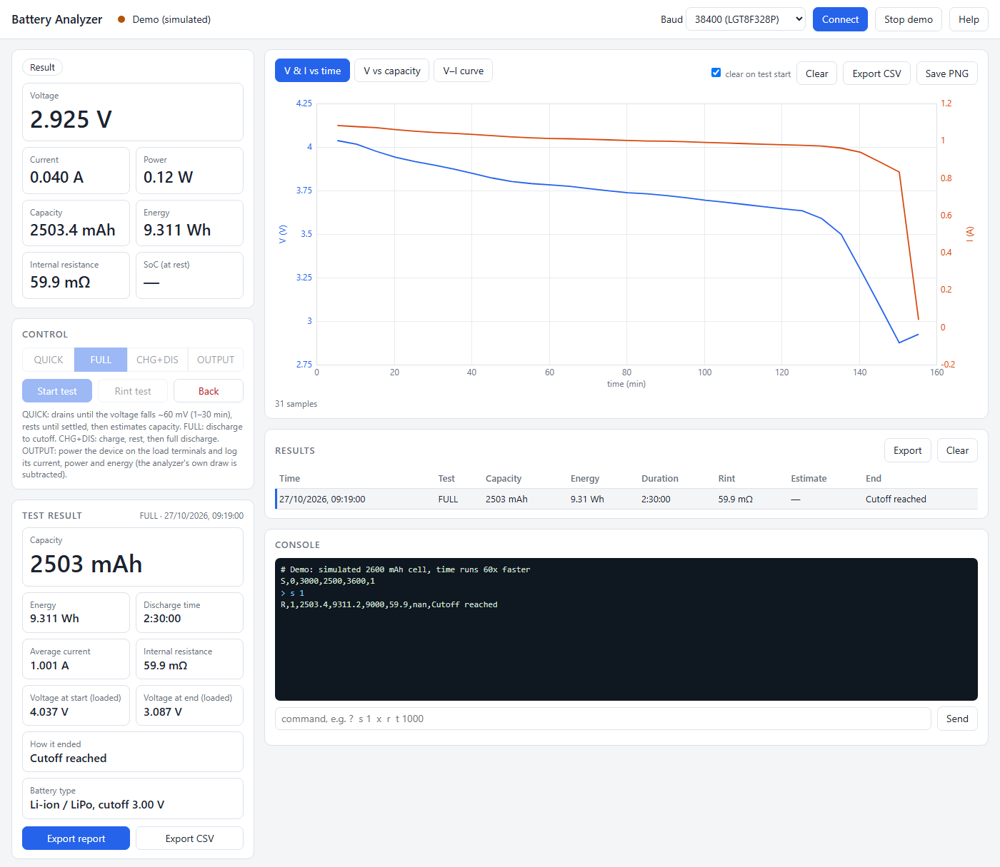
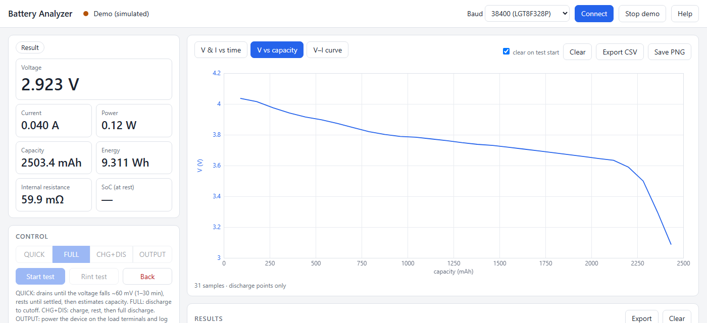
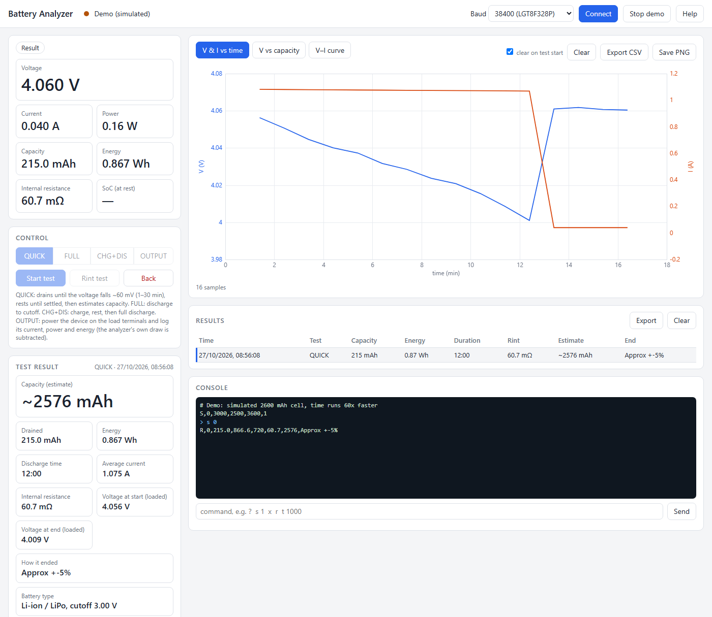

# Lithium Battery Analyzer

3.3 V Pro Mini (LGT8F328P clone or original ATmega328P / 8 MHz) + AD7705 16-bit ADC + 0.96" 128x64 I2C OLED (SSD1306, yellow/blue).
It measures a single Li-ion cell through a 0.02 Ω shunt in the cell's minus lead. The analyzer runs from the cell under test (5 V boost + 3.3 V regulator), so its own current is measured too.



**What it does**
- **Capacity:** full discharge to a cutoff voltage you set (mAh, Wh, time, average current), or charge-then-discharge with a TP4056.
- **QUICK estimate:** in about 5–45 minutes, from the change in resting voltage, rated ±5 % / ±10 % / low confidence.
- **Internal resistance:** at the press of a button.
- **OUTPUT mode:** powers a device from the cell and logs its current, power and energy.
- **Battery types:** Li-ion / LiPo, LiHV and LiFePO4, with cutoff stored on the chip.
- **Portable PC app:** [`tools/BatteryAnalyzer.html`](tools/BatteryAnalyzer.html), one file with nothing to install. Live charts, test results, HTML reports and CSV export over USB serial in Chrome or Edge.
- **Flash the firmware from the PC app:** no VS Code or compiler needed; the firmware for both boards is built in.

| Discharge curve (voltage vs capacity) | QUICK test: adaptive drain, rest, estimate |
|---|---|
|  |  |

**Try the app without hardware:** download `tools/BatteryAnalyzer.html`, open it in Chrome or Edge, and click **Demo**. A simulated cell runs 60× faster. You can also open `BatteryAnalyzer.html#demo&run=1&mode=1` to start a FULL test straight away. The screenshots come from that demo; regenerate them with `docs/screenshots.ps1`.

## Build in VS Code

1. Install the **PlatformIO IDE** extension (VS Code will suggest it).
2. Open this folder. Read the marking on the Pro Mini's chip and pick the matching environment in the PlatformIO status bar (or set `default_envs` in `platformio.ini`):

   | Chip marking | Environment | Serial / PC app baud | Settings stored in |
   |---|---|---|---|
   | **LGT8F328P** (default) | `promini_3v3_4mhz` | **38400** | emulated EEPROM in flash (program ≤ 29 696 bytes) |
   | **ATMEGA328P** (original 3.3 V / 8 MHz) | `promini_3v3` | **57600** | real EEPROM |

   Only **3.3 V** Pro Minis are supported. The AD7705 module, the OLED and the TP4056 status lines all run at 3.3 V logic, and the analyzer itself is powered from the cell through a boost converter and a 3.3 V regulator.
3. Build (✓) and Upload (→) with a USB-serial adapter (FTDI/CP2102, DTR to the Pro Mini's DTR/GRN pin), with the adapter set to **3.3 V**. Both boards upload the same way.
4. Serial monitor at **38400** (LGT8F) or **57600** (original). At power-up it prints `# F_CPU=4000000 CLKPR=0x3` on the LGT board or `# F_CPU=8000000` on the original. If the text is unreadable, the wrong environment was uploaded. It also prints the clock and AD7705 diagnostics at power-up, errors as `# ERROR: ...`, and a telemetry line every second (see *PC software*).

> If serial text is unreadable but works at half the baud rate, the board's real clock is half of what the build assumes. Use the 4 MHz build.

> On Windows, keep the project in a short path (e.g. `C:\proj\battery-analyzer`).
> Very long paths break PlatformIO's library unpacking.

Size: about 28 KB flash (limit 29 696 bytes on the LGT8F build) and 0.8 KB RAM. The OLED driver (SSD1306Ascii) writes text straight to the display, with no frame buffer.

## Wiring

Full schematic: [docs/schematic.pdf](docs/schematic.pdf). Sheet 1 is the controller, ADC, display and controls; sheet 2 is the power path, load, shunt and charger.
It's generated by `docs/schematic.py` (`pip install schemdraw matplotlib pypdf`, then `python docs/schematic.py`).

```
                    Pro Mini (3.3 V)
  OLED     SDA ---- A4                  D2  ---- START button ---- GND
  (4-pin   SCL ---- A5                  D3  ---- MODE  button ---- GND
   I2C)    VCC ---- 3.3V                D4  ---- RINT  button ---- GND
           GND ---- GND                 A1  ---- 100R ---- gate of N-MOSFET (load switch)
                                        A2  ---- 1k ---- NPN base (charger power switch)
                                        A3  ---- 10k ---- TP4056 STDBY pin
                                        D7  ---- 10k ---- TP4056 CHRG pin
           D8, D9, A0 unused; D10 must stay unconnected (SPI select pin)
  AD7705   CS  ---- D6
           DRDY---- D5
           RST ---- 3.3V (reset is done over SPI)
           DIN ---- D11 (MOSI)
           DOUT---- D12 (MISO)
           SCK ---- D13 (SCK)
           VCC ---- 3.3V, GND ---- GND
```

### Power path (shunt in the cell minus lead)

```
 BAT+ ──┬──────────────────────[ external load / device ]──── drain  Q1 N-MOSFET ── source ──┐
        │                                                    (gate: A1 via 100R, 100k to GND)  │
        ├── sense wire ── AD7705 module AIN2+ (module divides by 2; AIN2- = GND on module)      │
        ├── SW1 power ── U5 5 V boost ── +5V ── U6 3.3 V regulator ── +3V3 (MCU, AD7705, OLED) │
        └── TP4056 BAT+                                                                       │
                                                                                              │
 BAT- ── sense wire ── AD7705 module AIN1+ (module divides by 2; AIN1- = GND on module)        │
   │                                                                                          │
 0.02 Ω shunt                                                                                 │
   │                                                                                          │
 STAR GND ── AD7705 module GND, boost/regulator GND, TP4056 BAT-, Q1 source ──────────────────┘
```

- **All cell current goes through the shunt:** the load, the analyzer's own electronics (about 30–60 mA through the boost), and charge current, which reads **negative**.
- **STAR GND is the GND end of the shunt.** Everything else joins there. The cell's minus terminal sits slightly *below* GND (I × Rs, e.g. −50 mV at 2.5 A).
- **The AD7705 module is used unmodified.** Each input has a 10k/10k divider (÷2), and AIN1−/AIN2− are tied to GND on the module. So:
  - **Voltage:** the BAT+ sense wire goes straight to **AIN2+**, no external divider. 4.2 V reads 2.1 V at the chip (limit 2.5 V), so up to 5.0 V can be measured (`VDIV_RATIO 2.000`).
  - **Current:** the **cell minus** goes to **AIN1+**. The module's GND is the shunt's other end. The divider halves the shunt voltage, so the chip sees −25 mV at 2.5 A, inside its −30 mV limit. The firmware flips the sign (`SHUNT_SIGN -1`) and doubles it (`SHUNT_DIV 2`).
- **Current range:** **2.5 A** maximum discharge (the firmware aborts above that). The shunt channel is bipolar, gain 64 (±39 mV at the chip = ±3.9 A scale), with about 120 µA resolution. The −30 mV input limit, not the scale, sets the 2.5 A maximum.
- **Calibrate:** the module dividers put 5 kΩ in front of the ADC's unbuffered inputs, which causes a small fixed scale error. The `v` and `i` calibration removes it, so **do the calibration once**.
- **Voltage correction:** AIN2 measures BAT+ against GND, so the firmware adds the shunt drop (I × Rs) back to get the true cell voltage.
- **Kelvin wiring:** run the BAT+ sense wire and the cell-minus wire to the module as **separate thin wires** straight from the cell terminals. Carry load current only on the heavy wires.
- **Rint:** measured from the voltage and current *step* when the load switches on, so the electronics' own draw cancels out.
- **Charging:** needs a separate USB 5 V input on the TP4056 (it can't charge from its own boost). Its BAT− goes to GND, not to the cell, so charge current is measured.
- **Power-off:** the electronics keep draining the cell after a test ends. **Switch SW1 off** when you're done.
- **Programming:** don't connect the FTDI adapter's VCC while the analyzer runs from the cell; GND, TX, RX and DTR are enough.
- TP4056 STDBY/CHRG are open-drain LED pins. The 10k series resistors protect the 3.3 V inputs. Internal pull-ups are used.
- This AD7705 module has a 4.9152 MHz crystal and an **LM285-2.5** reference (2.5 V ±1.5 %, the 8-pin chip marked `285-25`). Measure it (pin 8 to pin 4) and put the value in `ADC_VREF`. With a 2.4576 MHz crystal, set `ADC_CLOCK_REG 0x04`.

### Switching between the two Pro Mini boards
- **Wiring:** identical on both boards: same pins, same 3.3 V supply. Only the firmware build differs.
- **Switching:** select the other environment, upload, and set the PC app's baud rate (38400 LGT8F / 57600 original).
- **A wrong build doesn't damage anything,** but it runs at the wrong speed. You'd see unreadable serial text, wrong timing and wrong mAh.
- **Settings stay with each chip:** a newly flashed board starts at the defaults (Li-ion, 3.00 V); set them once from the PC app.
- **Calibration** (`ADC_VREF`, `V_CAL`, `I_CAL` in `config.h`) belongs to one physical unit. Calibrate each analyzer you build.

### OLED notes
- The OLED runs on I2C at 100 kHz; 400 kHz isn't reachable with a 4 MHz CPU. At startup the firmware looks for it at 0x3C and 0x3D and prints `# OLED at 0x3C` on serial.
- Uses a ready-made **4-pin I2C module** (GND, VCC, SCL, SDA). It has its own pull-ups and reset circuit, so no extra parts are needed, and `PIN_OLED_RST` is `-1`.
- With an SPI module converted to I2C instead, add 4.7k pull-ups from SDA and SCL to 3.3 V, wire RES to D8, and set `PIN_OLED_RST 8`.
- During a test the screen dims after 1 minute to limit burn-in (`OLED_DIM_CONTRAST` and `OLED_DIM_AFTER_MS` in `config.h`).
- For a 1.3" SH1106 module, set `OLED_TYPE SH1106_128x64`.

## Operation

| Action | What happens |
|---|---|
| Power-up | For 2 s the screen shows **SETTINGS**: the stored battery type and cutoff voltage. |
| Idle | Live battery voltage, current, OCV-based SoC, last Rint, battery type and cutoff. The selected mode is shown in the title. |
| **MODE** | Cycle QUICK → FULL → CHG+DIS → OUTPUT (starts on FULL at power-up). |
| **START** | Start the selected test, or switch the output on. |
| **RINT** | Internal resistance: load off 1 s → open-circuit V; load on 1 s → loaded V and I. `Rint = (Voc − Vload) / (Iload − Iidle)`. |
| Hold START or RINT 1.5 s during a test | Abort (load and charger off; partial results shown). |
| START or RINT while the output is on | Switch the output off (a short press is enough). |
| START or RINT on result/error screen | Back to idle. |

### QUICK (estimate, adaptive)
1. Measure Rint and the resting voltage OCV₀.
2. Discharge until the *estimated* resting voltage `V + I × Rint` has dropped `QUICK_TARGET_MV` (60 mV), counting mAh. The drain lasts at least `QUICK_MIN_S` (60 s), so polarization alone can't end it, and at most `QUICK_MAX_S` (30 min). The screen shows the progress, e.g. `dV 23/60mV`.
3. Rest until the voltage has settled, i.e. it rises less than `QUICK_SETTLE_MV` (1 mV) per minute. The rest lasts 3–15 min; then measure OCV₁.
4. If OCV₁ is less than `QUICK_MIN_DV_MV` (40 mV) below OCV₀, run one more drain-and-rest round ("QUICK DRAIN 2").
5. `capacity ≈ mAh_out / (SoC(OCV₀) − SoC(OCV₁))`, using the selected chemistry's OCV→SoC table.

The result is rated by how far the resting voltage moved: **Approx +-5%** (≥ 50 mV), **+-10%** (30–50 mV) or **Low confidence**. If the SoC change is under 3 %, it shows `N/A` ("dSoC too small").

How long it takes depends on the C-rate (load current ÷ capacity) and where the cell starts:
- **Small cells or heavy loads:** a few minutes.
- **Large cells in the flat middle of the curve (40–70 %):** up to the 30-minute limit.

Best accuracy comes from 0.5–1C. On LiFePO4 the curve is almost flat, so QUICK is only a rough guide there.

### FULL discharge
Rint is measured first. Then the cell discharges until the loaded voltage stays below the cutoff voltage (a stored setting, default 3.0 V for Li-ion) for 5 samples in a row. The result shows mAh, Wh, time, average current and Rint.

### CHG+DIS (charge, then discharge)
**Li-ion / LiPo only.** The TP4056 charges to 4.2 V, so the firmware refuses this mode for LiHV and LiFePO4 ("TP4056: Li-ion").
The TP4056 charges the cell until STDBY reports full. The cell then rests `CHG_REST_S` (10 min). Rint is measured, and a full discharge to cutoff follows. With `RECHARGE_AFTER_TEST 1`, it recharges the cell afterwards while showing the result.

### OUTPUT (power a device and measure it)
Connect the device to the **load terminals** instead of RL: device + to BAT+, device − to the MOSFET drain. The MOSFET switches the device's minus side.

1. With the output still off, the analyzer measures its own current (about 30–60 mA) as a baseline.
2. START switches the output on. The screen and the PC app show the **device's** current (total minus baseline), power, mAh and Wh used, run time, and minimum and maximum current.
3. The output switches off when you press START or RINT (a short press), when the cell reaches the cutoff voltage, above 2.5 A, or after `DIS_TIMEOUT_S`. The result shows energy used, run time, and average and maximum current.

In the PC app, *V & I vs time* shows the device's current and battery voltage, *V vs capacity* shows voltage against the mAh it used, and *V–I curve* shows its current at each battery voltage.

Limits: the device sees the cell voltage (4.2 → 3.0 V). Below ~20 mA the reading is rough, because the analyzer's own current varies by a few mA. Short current pulses are averaged (about 5 readings per second).

## PC software (portable)

[`tools/BatteryAnalyzer.html`](tools/BatteryAnalyzer.html) is the whole program: one file, nothing to install. Copy it anywhere, e.g. onto a USB stick.

1. Open it in **Chrome or Edge**. Both can use serial ports from a web page (Web Serial); Firefox can't. If double-clicking opens another browser, right-click the file → *Open with* → Microsoft Edge.
2. Choose the baud rate (**38400** for this unit), click **Connect**, and pick the COM port.
3. To try it without hardware, click **Demo**. It simulates a 2600 mAh cell with time running 60× faster.

**Features:**
- **Live readings:** voltage, current, power, capacity, energy, internal resistance, state of charge, and the test state.
- **Control:** select the mode, start a test, run a Rint test, abort, or go back. These do the same as the three buttons.
- **Charts:**
  - **V & I vs time:** voltage and current on two axes.
  - **V vs capacity:** the discharge curve.
  - **V–I curve:** every reading, plus each load step (load switching on or off) drawn as a segment labelled with its resistance ΔV/ΔI.
  - **Hover** on a chart for exact values. **Export CSV** saves the raw data, **Save PNG** saves the chart.
- **Test result card:** appears, highlighted, when a test finishes. It shows capacity (or QUICK estimate / energy used by an OUTPUT device), energy, time, average current, Rint (OUTPUT: min/max current), start and end voltage, how it ended, and battery type and cutoff.
  - **Export report:** an HTML page with the summary and this test's charts. Open it in a browser, print it, or *Print → Save as PDF*.
  - **Export CSV:** the summary followed by all of this test's readings.
- **Results table:** every finished test and Rint measurement, kept in the browser between sessions; **Export** saves it as CSV.
  - **Click a row** to reopen that result in the Test result card, with its charts and exports. Each test's readings are stored in the browser's IndexedDB; the list itself is in localStorage.
  - **Clear** deletes both the list and the stored readings.
- **Calibration panel:** switch the load on or off, enter your multimeter readings, and copy the resulting `V_CAL` / `I_CAL` lines into `config.h`.
- **Console:** all device messages, plus a box for typing commands.

> **Connecting resets the board.** Opening the COM port toggles DTR, which restarts the Pro Mini like an upload does. Connect *before* starting a long test. To connect mid-test without a reset, leave the adapter's DTR wire unconnected; you then press reset by hand when uploading.

### Flashing a board from the PC app (no VS Code)
The PC app carries the compiled firmware for both boards and can flash a Pro Mini by itself through the USB-serial adapter. It speaks the Arduino bootloader protocol (STK500v1 at 57600 baud, like `avrdude -c arduino`).

1. Wire the adapter including **DTR**, at 3.3 V, and close other serial monitors.
2. Open **Firmware update**, choose the board (**LGT8F328P** or **ATmega328P 3.3 V / 8 MHz**), and keep **Bundled firmware**, or pick a `.hex` file.
3. Click **Flash firmware** and pick the COM port. The app resets the board, writes and verifies every page, and reconnects at the board's baud rate.

**Without DTR:** press reset when "Resetting the board…" appears.

**Blank chips:** a new Pro Mini already has its bootloader. A truly blank ATmega328P needs the bootloader burned once with an ISP programmer.

**Stored settings** (battery type, cutoff) are kept.

**After changing the firmware**, refresh the bundled copies with `python tools/embed_firmware.py`. It builds both environments and writes their `.hex` files into `BatteryAnalyzer.html`, labelled with the date and Git version.

### Serial protocol

Lines from the analyzer:

| Line | Meaning |
|---|---|
| `D,ms,state,mode,V,A,mAh,mWh,rint_mOhm` | telemetry every `TELEM_MS` (1 s); current is negative while charging |
| `R,mode,mAh,mWh,seconds,rint_mOhm,estimate_mAh,end` | test finished |
| `O,avg_A,min_A,max_A` | OUTPUT session summary, right after its `R` line |
| `K,rint_mOhm,ocv` | Rint test result |
| `S,chem,cutoff_mV,min_mV,max_mV,can_charge` | settings, at power-up and after each change |
| `# ...` | messages, `# ERROR: ...` |
| `#define V_CAL ...` / `#define I_CAL ...` | calibration result |

State: 0 idle, 1 quick drain, 2 quick rest, 3 charging, 4 rest, 5 discharging, 6 result, 7 error, 8 output on. Mode: 0 QUICK, 1 FULL, 2 CHG+DIS, 3 OUTPUT. In state 8 the `A`, `mAh` and `mWh` fields are the device's only.

Commands (one per line):

| Command | Action |
|---|---|
| `s [n]` | start a test (optionally select mode `n` first) |
| `x` | abort a running test / leave the result or error screen |
| `r` | Rint test |
| `p <n>` | select mode |
| `t <ms>` | telemetry interval, `0` = off |
| `c <n>` | battery type: 0 Li-ion/LiPo, 1 LiHV, 2 LiFePO4 (also sets its default cutoff); saved on the chip |
| `u <volts>` | cutoff voltage; saved on the chip |
| `g` | print the settings (`S` line) |
| `m`, `v`, `l`, `i`, `?` | calibration, see below |

`s`, `r`, `p`, `c`, `u`, `v`, `l` and `i` only work on the idle screen.

## Battery types and cutoff voltage

Set them in the PC app (*Calibration & settings* → *Battery settings* → *Save to analyzer*) or with `c` / `u`. They're **stored on the chip** and survive power-off. The idle screen shows them, e.g. `Li-ion/LiPo 3.00V`.

| Type | Full | Default cutoff | Allowed cutoff | CHG+DIS |
|---|---|---|---|---|
| Li-ion / LiPo (LCO, NMC) | 4.20 V | 3.00 V | 2.50–3.60 V | yes |
| LiHV | 4.35 V | 3.00 V | 2.50–3.60 V | no |
| LiFePO4 | 3.65 V | 2.50 V | 2.00–3.00 V | no |

The type also selects the voltage-to-charge (OCV→SoC) table in [src/battery.cpp](src/battery.cpp) used for the SoC reading and the QUICK estimate.

**Not supported:** NiMH, NiCd and LTO. The analyzer runs from the cell under test, and its boost converter needs at least ~2 V.

**Where settings are stored:**
- **LGT8F328P (this unit):** it has no real EEPROM; the chip emulates 1 KB of it in flash at 0x7800–0x7FFF, above the LGT bootloader (0x7400–0x77FF). The `promini_3v3_4mhz` build therefore limits the program to **29 696 bytes** (`board_upload.maximum_size`) and defines `LGT8F`.
- **Genuine ATmega328P builds:** the normal EEPROM is used.
- **Invalid or empty storage:** the defaults (Li-ion, 3.00 V) are used.

## Calibration

Use the PC software's calibration panel, or type these commands in any serial monitor (Enter after each). They work on the idle screen.

| Command | What it does |
|---|---|
| `?` | Help and the current `V_CAL` / `I_CAL` |
| `m` | Toggle a live readout every second: `V`, `I`, and the raw voltages at the AD7705 pins `AIN2` (voltage) and `AIN1` (shunt), in mV |
| `v 3.987` | Set the voltage factor: type the voltage your multimeter shows **at the cell terminals** (load off) |
| `l 1` / `l 0` | Switch the load on / off (on switches itself off after 60 s) |
| `i 1.234` | Set the current factor: type the current your multimeter shows **in series with the cell lead** (load on) |

New factors take effect at once, and the firmware prints them like `#define V_CAL 1.01234f`. They're lost at power-off, so **copy both lines into `include/config.h`** and upload again.

**Step by step:**
1. **Check the basics first** if a reading is far off (more than ~5 %); a calibration factor shouldn't hide a wiring fault:
   - **ADC reference:** measure REF+ to REF− on the AD7705 module. If it isn't 2.500 V, set `ADC_VREF` to the measured value.
   - **Module dividers:** with power off, measure the two 10k resistors on the AIN2 input and set `VDIV_RATIO = (Rtop + Rbottom) / Rbottom` (2.000 for equal values).
   - **Raw inputs:** with `m` on, `AIN2` should be about Vbat / 2, and `AIN1` about **−10 mV per amp** (negative while discharging; load + electronics).
2. **Voltage:** load off, measure the cell at its terminals with the multimeter, send `v <reading>`.
3. **Current:** put the multimeter (10 A range) in series with the cell's minus lead, so it sees the same total current as the shunt. Send `l 1`, wait a few seconds, then send `i <reading>`, then `l 0`. A 1–2 A load gives the best accuracy.
4. Copy the printed `V_CAL` and `I_CAL` lines into `config.h` and upload.

There's no automatic zero offset: with the analyzer powered from the cell, some current always flows. The AD7705's self-calibration at power-up removes its own offset.

## Safety
- The firmware boots with the load and charger **off**. Add a 100k pull-down on the MOSFET gate so the load stays off during reset or programming.
- No temperature sensing: don't leave tests unattended with high currents. Size the load resistor's power rating (e.g. 4 Ω at 4.2 V ≈ 4.4 W).
- Set the right **battery type** before testing. CHG+DIS is blocked for LiHV and LiFePO4 because the TP4056 would charge them wrongly.
- Lithium cells can catch fire when shorted, overcharged or damaged. You build and use this analyzer at your own risk.

## Credits
- [SSD1306Ascii](https://github.com/greiman/SSD1306Ascii) by Bill Greiman: OLED text driver (MIT).
- [Arduino AVR core](https://github.com/arduino/ArduinoCore-avr): framework (LGPL 2.1).
- [lgt8fx](https://github.com/dbuezas/lgt8fx): the LGT8F328P emulated-EEPROM register sequence follows its EEPROM library.
- [schemdraw](https://schemdraw.readthedocs.io/): used by `docs/schematic.py` to draw the schematic.
- Firmware, PC software and documentation were developed with the help of an AI assistant (Claude).

## License
[MIT](LICENSE) © 2026 Ashoka Munasinghe · [www.electronics.lk](https://www.electronics.lk)
